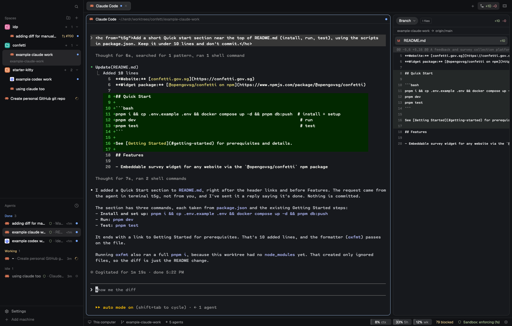
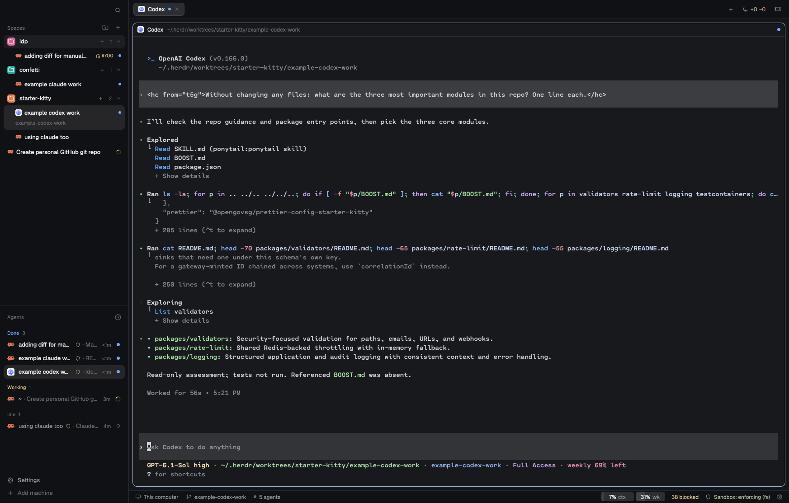
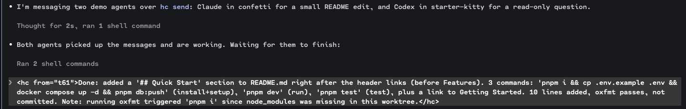
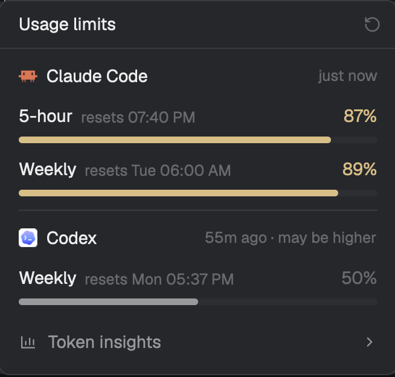

# herdr-config

My setup for the [Herdr](https://herdr.dev) app, the desktop app for terminals and coding agents.
It's a layout plus a set of mods and scripts that you install into Herdr's config folder.

What you get:

- **Sandboxed agents.** Claude Code and Codex start inside a macOS sandbox that can't read your home folder or write outside the project, except for paths you allow.
- **Worktree spaces.** A new space can be its own git worktree, with your repo's setup run before the agent starts and its teardown run before the space closes.
- **A Changes panel with modes.** Last Turn, Uncommitted, Unstaged, Staged, a single commit, or the whole branch.
- **Linear and GitHub at a glance.** The branch's Linear ticket in a panel, and each space's pull request and CI state in the sidebar.
- **A usage footer.** Context, 5-hour and weekly usage for the focused agent, and what the sandbox blocked.

It only works on macOS, because the sandbox uses `sandbox-exec`.

## What it looks like



Spaces grouped in sidebar folders, each row with its agent and pull request, and the agents list below.
On the right, the Changes panel in Branch mode shows what this branch changed against `origin/main`.
The footer has the agent's context and usage, and the sandbox state.



Agents can message each other with `hc send`.
Here Codex answers a question another agent sent it, marked `<hc from="t5g">`.



The reply comes back the same way: a Claude Code agent reports what it did to the agent that asked.

## Requirements

- The Herdr app, started at least once (it creates `~/.config/herdr-app`).
- `jq`.
- `claude` and/or `codex`.
- Optional: `gh`, signed in with `gh auth login`, for pull requests in the sidebar.
- Optional: a Linear personal API key, for the Linear panel.
- Optional: Google Chrome, for the shared browser agents can drive.

## Install

```sh
git clone https://github.com/karrui/herdr-config.git
./herdr-config/install.sh
```

The script copies everything into `~/.config/herdr-app` and switches the window to the **main-sandbox** layout.
Any file it replaces is kept beside it as `<file>~`, including your `keys.json` and `programs.json`.
If Herdr wasn't open, press `cmd-shift-l` until the window shows main-sandbox.

The files are copied rather than symlinked on purpose.
Herdr runs these scripts outside the sandbox, and the sandbox only protects Herdr's own folder from agents, not a checkout somewhere else.

### Show usage in the footer (Claude Code)

The footer reads Claude Code's status line data.
Add this line to your status line script, the one `statusLine.command` points at in `~/.claude/settings.json`:

```sh
printf '%s' "$input" | ~/.config/herdr-app/usage/claude-statusline
```

Here `$input` is the JSON your script reads from stdin.
If you don't have a status line yet, set `statusLine.command` to `~/.config/herdr-app/usage/claude-statusline` instead.
It prints nothing, so Claude Code's own status line stays empty.
Codex needs no setup.

### Set up worktrees for your repo

Worktree setup and teardown are per repo, in `~/.config/herdr-app/worktrees/<repo>.yaml`:

```yaml
repo: "~/Projects/my-app"
# Copied from the main checkout into each new worktree.
copy:
  - ".env"
# Runs in a Setup pane before the agent starts.
setup: |
  pnpm install --frozen-lockfile
# Runs before the worktree is removed or its space closes.
teardown: |
  docker compose down --volumes
```

To edit one from the app, make a sidebar folder and set it to start its spaces in the repo (**Edit folder…**), then right-click it and choose **Edit worktree setup…**.
A repo with a `.termic.yaml` or `.worktreeinclude` gets its file written from those the first time.
These files are yours: they live only in `~/.config/herdr-app/worktrees`, and installing or updating never touches them.

## Using it

### Starting agents

The **+** in the tab bar starts Claude Code or Codex in the sandbox.
"Claude Code (no sandbox)" and "Codex (no sandbox)" start them without it.

New spaces start from the **+** in the sidebar.
Pick **Worktree** to give the space its own branch and checkout in `~/.herdr/worktrees/<repo>/<branch>`.
The branch is always new, cut from the remote's default branch right after fetching it.
If the name is taken, here or on the remote, it gets `-2`, `-3` and so on, and a toast names the branch it made.

### The sandbox

A sandboxed agent can read and write its starting folder and the paths in `~/.config/herdr-app/sandbox/allow.txt`.
Paths in `deny.txt` beside it are always blocked, even inside the project.
The first install starts both lists from `sandbox/allow.default.txt` and `deny.default.txt`; after that they're yours, and updating never replaces them.
The starter list covers the agents' own state, common caches and your shell and git dotfiles, so expect to allow a few paths your own tools need.
SSH agent sockets and `AWS_*` variables are kept from it.
Sockets in your home folder are blocked as well: Herdr's own (`hc`, `herdr-app`), Docker's, 1Password's and other apps' control sockets, which would let an agent run commands outside the sandbox.
A `socket <path>` line in `allow.txt` opens one, such as Docker's for tests, at the cost of that escape.
Sandboxed agents still use `hc`, through a go-between (`sandbox/hc-broker`) that runs beside each one: `hc run` starts the new program sandboxed, in a folder the agent can already write, and messages, reads and waits only reach sandboxed terminals and the agent's own children.
`deny.txt` also lists paths that are readable but never writable (`write <path>` lines): shell and git startup files, tools on your `PATH`, and the agents' settings, hooks, plugins and skills.
Code planted there would run later outside the sandbox.
`gh`, `git` and the network still work.

The footer shows "N blocked" when the sandbox stopped something.
Click it to see what, and to allow a path.
The settings icon at the end of the footer edits both lists.

List changes only apply when an agent starts.
Right-click the agent's tab and choose **Restart agent**: it restarts in the same sandbox mode and resumes its conversation.
To turn the sandbox on or off for an agent, click "Sandbox: …" in the footer.

### Closing worktree spaces

Closing a worktree space from its menu, its tab menu or its last tab's **×** asks first, then runs the repo's teardown.
The space stays in the sidebar, struck through with the teardown's progress, and closes when it's done.
The worktree folder is then deleted if it has no uncommitted changes; otherwise it's kept and a toast says so.
The branch always stays.

Closing its last tab with `cmd-w` can't wait for the teardown, so the teardown runs right after the space is gone.
**Remove worktree** in a space's menu deletes the worktree even with uncommitted changes, after warning.

### The Changes panel

The dropdown at the top picks what the panel compares:

- **Last Turn**: what the focused agent changed since it last started working.
- **Uncommitted**, **Unstaged**, **Staged**: the working tree against `HEAD`, the working tree against what's staged, or what's staged against `HEAD`.
- **Committed**: one commit, picked from this branch's commits (or the latest 30).
- **Branch**: everything on this branch since it left `origin`'s default branch, uncommitted work included.

Last Turn only knows turns that started while the panel was running, so it starts tracking the first time you open the panel.
The Changes button in the tab bar shows the branch's lines added and removed.

### Linear

The Linear button in the tab bar shows the focused branch's ticket id, and opens the ticket in a panel.
The first time, the panel asks for a Linear personal API key, which you create in Linear's Security & access settings.
It's saved to `~/.config/herdr-app/data/linear/api-key`, where sandboxed agents can't read it.

The ticket is found in this order:

1. A ticket you linked to the branch by hand.
2. A ticket id in the branch name, such as `devx-684-fix`, if `DEVX` is one of your teams.
3. The issue Linear itself ties to the branch.

Right-click the Linear button to link a different ticket, stop or restore detection, open the ticket, or change the API key.

### The sidebar

- A space whose branch has a pull request shows it, like `#698`; click it to open it on GitHub.
  Purple is merged, grey is closed or draft, red is a failing check, yellow is checks running, and green is checks passed.
- A space you haven't named shows its agent's session title.
- Folders group spaces: make one with the folder button at the top, then drag spaces onto it.
  `cmd-alt-[` and `cmd-alt-]` step through spaces in the order the sidebar shows them.
- Spaces with an agent, and folders with a terminal open, come first.
  The rest go under an Inactive line, in each folder and at the bottom; click it to fold them away.
- **Usage**, above Settings, shows Claude Code's and Codex's plan limits: each 5-hour and weekly window, when it resets, and how old the reading is.
  They're account-wide, as each agent last reported them, so Claude Code needs the status line set up above.

  

## Updating

Pull, then run `./install.sh` again.
Your own edits to these files in `~/.config/herdr-app` are overwritten, but each one is kept as `<file>~`.
Your sandbox lists and worktree setups are left alone.

## Going back

Press `cmd-shift-l` to switch back to Herdr's own layout.
If anything leaves the window unusable, `ctrl-alt-shift-escape` always resets it to the default layout and keys.
To restore a file the install replaced, rename its `<file>~` copy back.

## What's in it

| Path | What it does |
|---|---|
| `layouts/main-sandbox.json` | The layout that puts the mods together. |
| `keys.json` | Key bindings. `cmd-b` is unbound, so the sidebar always shows. |
| `programs.json` | Points the + menu's agents at `agent/launch`. |
| `agent/launch` | Starts `claude` or `codex` with `agent/instructions.md` added, sandboxed or not. |
| `agent/worktree` | Worktree setup, teardown, removal and close, driven by your `worktrees/<repo>.yaml` files. |
| `sandbox/` | The sandbox (`agent-sandbox`), its `hc` go-between (`hc-broker`, `bin/hc`), starter allow and deny lists, the blocked-access logger and `agent-restart`. |
| `usage/` | The context and usage feeds for Claude Code and Codex, for the footer and the Usage popup. |
| `browser/open` | A shared Chrome, inside the sandbox, that agents drive over CDP on port 9222. |
| `mods/agent-bar` | The footer: usage, sandbox state and blocked accesses. |
| `mods/usage`, `footer-sandbox` | The Usage popup, and the sidebar footer that opens it. |
| `mods/space-folders` | The sidebar: folders, worktree spaces, pull requests, close-time teardown. |
| `mods/changes-sandbox` | The Changes panel with modes. |
| `mods/linear` | The Linear panel, its right-click menu and dialogs. |
| `mods/tabs-sandbox` | The tab bar, with the Changes, Linear and containers buttons. |
| `mods/worktree-hooks`, `worktree-setup`, `resources` | The worktree dialogs, the setup editor and a worktree's containers. |
| `mods/menu-hooks` | Right-click menus, including Restart agent. |
| `mods/brand-sandbox` | The sidebar's top bar: only search. |
| `mods/agents-sandbox`, `new-menu-sandbox`, `status-sandbox`, `sandbox-lists` | Herdr's agents list, + menu, status bar and a sandbox lists editor, adapted to the sandbox. |

Mods can't import each other, so `mods/tabs-sandbox/linear-resolve.js` is a copy of `mods/linear/resolve.js`, and `mods/worktree-hooks/fresh-worktree.js` of `mods/space-folders/fresh-worktree.js`.
Change both together.
