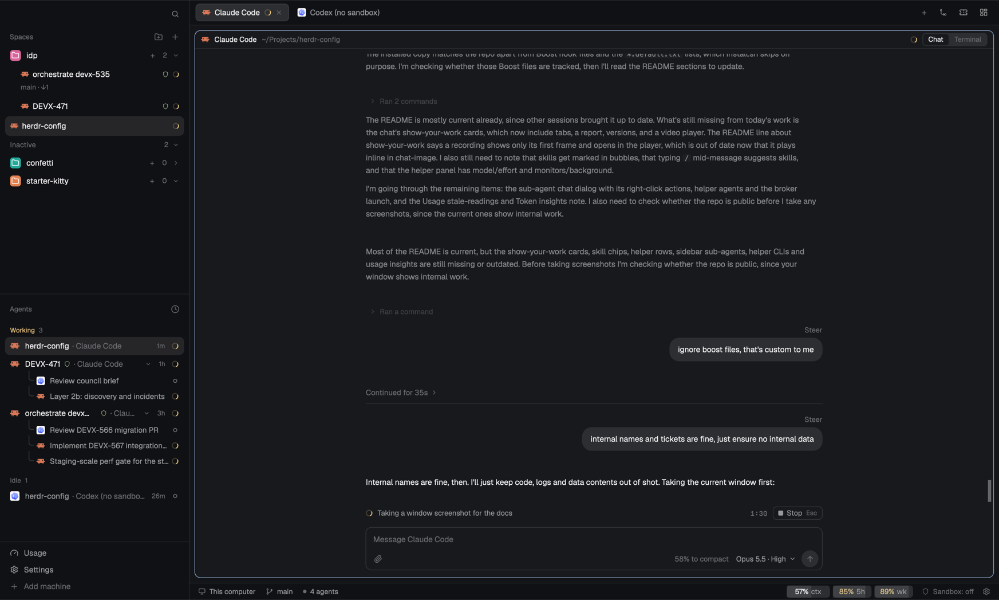

# herdr-config

My setup for the [Herdr](https://herdr.dev) app, the desktop app for terminals and coding agents.
It's a layout plus a set of mods and scripts that you install into Herdr's config folder.

What you get:

- **Sandboxed agents.** Claude Code and Codex start inside a macOS sandbox that can't read your home folder or write outside the project, except for paths you allow.
- **Worktree spaces.** A new space can be its own git worktree, with your repo's setup run before the agent starts and its teardown run before the space closes.
- **Native diff reviews.** The Review bar opens worktree, branch and commit diffs in the side panel, with reviewed-file marks and split diffs.
- **Linear and GitHub at a glance.** The branch's Linear ticket in a panel, and each space's pull request and CI state in the sidebar.
- **A usage footer.** Context, 5-hour and weekly usage for the focused agent, and what the sandbox blocked.

It only works on macOS, because the sandbox uses `sandbox-exec`.

## What it looks like


Spaces grouped in sidebar folders, each row with its agent and pull request, and the agents list below.
This older screenshot includes the previous Changes panel; the Review bar now opens the native review in that side panel.
The footer has the agent's context and usage, and the sandbox state.


Agents can message each other with `hc send`.
Here Codex answers a question another agent sent it, marked `<hc from="t5g">`.


The reply comes back the same way: a Claude Code agent reports what it did to the agent that asked.



Chat shows an agent as a conversation, with its terminal one click away.
Use the search icon beside Chat / Terminal, or **Cmd+F / Ctrl+F**, to find text and jump between matches
with **Enter / Shift+Enter** or the arrows. Matching replies inside collapsed turns open automatically.
**Search earlier** reads another page of history; **Escape** closes search.
Messages sent while it worked are marked Steer, and the work after them folds under "Continued for".
In the Agents list, each agent's helpers sit under it, named by their task: Codex reviewers it started with `hc`, and Claude Code's own helpers.

## Requirements

- The Herdr app, started at least once (it creates `~/.config/herdr-app`).
- `jq`.
- `claude` and/or `codex`.
- [jin.review](https://github.com/JinJieBeWater/pulls.review/tree/multi-repo), for the native review pane: `bun add --global jin.review@0.3.4-fork.4` (put `~/.bun/bin` on your PATH).
- Optional: `gh`, signed in with `gh auth login`, for pull requests in the sidebar.
- Optional: a Linear personal API key, for the Linear panel.
- Optional: Google Chrome, for the shared browser agents can drive.

## Install

```sh
git clone https://github.com/karrui/herdr-config.git
./herdr-config/install.sh
```

The script copies everything into `~/.config/herdr-app` and switches the window to the **main-sandbox** layout.
Any file it replaces is kept beside it as `<file>~`, including your `keys.json` and `programs.json`.
If Herdr wasn't open, press `cmd-shift-l` until the window shows main-sandbox.

The files are copied rather than symlinked on purpose.
Herdr runs these scripts outside the sandbox, and the sandbox only protects Herdr's own folder from agents, not a checkout somewhere else.

### Show usage in the footer (Claude Code)

The footer reads Claude Code's status line data.
Add this line to your status line script, the one `statusLine.command` points at in `~/.claude/settings.json`:

```sh
printf '%s' "$input" | ~/.config/herdr-app/usage/claude-statusline
```

Here `$input` is the JSON your script reads from stdin.
If you don't have a status line yet, set `statusLine.command` to `~/.config/herdr-app/usage/claude-statusline` instead.
It prints nothing, so Claude Code's own status line stays empty.
Codex needs no setup.

### Set up worktrees for your repo

Worktree setup and teardown are per repo, in `~/.config/herdr-app/worktrees/<repo>.yaml`:

```yaml
repo: "~/Projects/my-app"
# Copied from the main checkout into each new worktree.
copy:
  - ".env"
# Runs in a Setup pane before the agent starts.
setup: |
  pnpm install --frozen-lockfile
# Runs before the worktree is removed or its space closes.
teardown: |
  docker compose down --volumes
```

To edit one from the app, make a sidebar folder and set it to start its spaces in the repo (**Edit folder…**), then right-click it and choose **Edit worktree setup…**.
A repo with a `.termic.yaml` or `.worktreeinclude` gets its file written from those the first time.
These files are yours: they live only in `~/.config/herdr-app/worktrees`, and installing or updating never touches them.

## Using it

### Starting agents

The **+** in the tab bar starts Claude Code or Codex in the sandbox.
"Claude Code (no sandbox)" and "Codex (no sandbox)" start them without it.

New spaces start from the **+** in the sidebar.
Pick **Worktree** to give the space its own branch and checkout in `~/.herdr/worktrees/<repo>/<branch>`.
The branch is always new, cut from the remote's default branch right after fetching it.
If the name is taken, here or on the remote, it gets `-2`, `-3` and so on, and a toast names the branch it made.

### The sandbox

A sandboxed agent can read and write its starting folder and the paths in `~/.config/herdr-app/sandbox/allow.txt`.
Paths in `deny.txt` beside it are always blocked, even inside the project.
It can also read Herdr's mods, but not Herdr's `data/` folder, where keys like Linear's live.
The first install starts both lists from `sandbox/allow.default.txt` and `deny.default.txt`; after that they're yours, and updating never replaces them.
The starter list covers the agents' own state, common caches and your shell and git dotfiles, so expect to allow a few paths your own tools need.
SSH agent sockets and `AWS_*` variables are kept from it.
Sockets in your home folder are blocked as well: Herdr's own (`hc`, `herdr-app`), Docker's, 1Password's and other apps' control sockets, which would let an agent run commands outside the sandbox.
A `socket <path>` line in `allow.txt` opens one, such as Docker's for tests, at the cost of that escape.
Sandboxed agents still use `hc`, through a go-between (`sandbox/hc-broker`) that runs beside each one: `hc run` starts the new program sandboxed, in a folder the agent can already write, messages reach any agent, prefixed so they can't start a `!` shell command there, and reads, keys and kills only reach sandboxed terminals and the agent's own children.
A worktree's agent can also use the main checkout's git data and its `.turbo` folder, where Turborepo keeps the cache all worktrees share.
`deny.txt` also lists paths that are readable but never writable (`write <path>` lines): shell and git startup files, tools on your `PATH`, and the agents' settings, hooks and skills.
Plugins stay writable, since their scripts install their own dependencies there.
Code planted there would run later outside the sandbox.
`gh`, `git` and the network still work.

The footer shows "N blocked" when the sandbox stopped something.
Click it to see what, and to allow a path.
The settings icon at the end of the footer edits both lists.

List changes only apply when an agent starts.
Right-click the agent's tab and choose **Restart agent**: it restarts in the same sandbox mode and resumes its conversation.
To turn the sandbox on or off for an agent, click "Sandbox: …" in the footer.

### Closing worktree spaces

Closing a worktree space from its menu, its tab menu or its last tab's **×** asks first, then runs the repo's teardown.
The space stays in the sidebar, struck through with the teardown's progress, and closes when it's done.
The worktree folder is then deleted if it has no uncommitted changes; otherwise it's kept and a toast says so.
Its local branch is deleted with it, unless you uncheck **Delete branch** in the Close dialog; closing any other way keeps the branch.

Closing its last tab with `cmd-w` can't wait for the teardown, so the teardown runs right after the space is gone.
**Remove worktree** in a space's menu deletes the worktree even with uncommitted changes, after warning.
It also deletes the worktree's local branch, unless you uncheck **Delete branch**; it warns when the branch has commits that aren't pushed anywhere.
The branch on GitHub stays.

### Reviewing changes

The Review bar at the top right replaces the Changes panel. Click a count to review the branch's commits, uncommitted files, or commits to push or pull. Branch and uncommitted buttons show lines added and removed in both Chat and Terminal view; worktree totals include new files and leave your staging index unchanged. Its logo opens a menu for picking a branch or commit. Counts use your existing remote-tracking refs; fetch when you want them updated.

A review opens in the same right-hand panel as Linear, Files and Artifacts. Click its active count again to close it. Mark files reviewed as you read, switch between unified and split diffs, or step through commits. Each tab keeps its selected diff; switching tabs never shows another tab's review. The bar follows the agent's current folder, including when its terminal is parked behind a chat pane.

The native bar and review come from [herdr-t3](https://github.com/JinJieBeWater/herdr-t3#pullsreview), with their source commit recorded in each mod's `SOURCE` file. They use the local `jin.review` daemon, started on first review. Opening a diff does not start an AI run, and the Code review button is omitted. Reviews currently support local repositories only.

### Linear

The Linear button in the tab bar shows the focused branch's ticket id, and opens the ticket in a panel.
The first time, the panel asks for a Linear personal API key, which you create in Linear's Security & access settings.
It's saved to `~/.config/herdr-app/data/linear/api-key`, where sandboxed agents can't read it.

The ticket is found in this order:

1. A ticket you linked to the branch by hand.
2. A ticket id in the branch name, such as `devx-684-fix`, if `DEVX` is one of your teams.
3. The issue Linear itself ties to the branch.

Right-click the Linear button to link a different ticket, stop or restore detection, open the ticket, or change the API key.

### The sidebar

- A space shows its pull requests: its branch's, the rest of a `gh stack` that branch is in, and every one its Claude Code sessions (sub-agents included) opened.
  One shows as `#698`; click it to open it on GitHub.
  Several show as `3 PRs`; hover it for the list, and click one to open it.
  Purple is merged, grey is closed or draft, red is a failing check, yellow is checks running, and green is checks passed.
  Several take the color of the one most in need.
- A space you haven't named shows its agent's session title.
- Folders group spaces: make one with the folder button at the top, then drag spaces onto it.
  `cmd-alt-[` and `cmd-alt-]` step through spaces in the order the sidebar shows them.
- Spaces with an agent, and folders with a terminal open, come first.
  The rest go under an Inactive line, in each folder and at the bottom; click it to fold them away.
- **Usage**, above Settings, shows Claude Code's and Codex's plan limits: each 5-hour and weekly window, when it resets, and how old the reading is.
  They're account-wide. Codex fetches its limits through `account/rateLimits/read`, using your existing Codex login,
  with one shared cache for the footer and panel refreshed every minute while Herdr is active.
  Claude uses the subscription endpoint its CLI uses (`/api/oauth/usage`), cached for three minutes with rate-limit backoff.
  That endpoint is undocumented and may change. Herdr reads the existing login without saving tokens or refreshing credentials.
  Neither needs an agent turn for account limits. If an API is unavailable, Herdr keeps the last reading or falls back to session reports.
  Context and cost still come from the conversation; Claude Code needs the status line set up above for those.
  The footer's usage popup also estimates what a Codex conversation would cost at standard API token rates,
  accounting for cached input, model changes, and long-context pricing. Tool fees and separate helper sessions are excluded;
  an estimate is hidden if any model in the conversation has no known price (`usage/codex-session`).
  A reading older than half an hour is dimmed, as use elsewhere isn't in it, and a window that has reset since reads 0%.
  **Token insights** at its foot opens a dashboard of tokens by model and day, from the agents' session logs (`mods/insights`).

  

### Closing and resuming agents

`cmd-w` on a tab running an agent doesn't end it: the tab closes, and the agent keeps running without a pane.
The tab's × still ends it.
**Resume a session…** in the tab bar's **+** menu lists this space's parked agents (**Open** gives one a tab again), then the Claude Code and Codex sessions that ran in its folders and ended.
**Resume** starts one again in a new tab, in the sandbox; **No sandbox** starts it outside.

### Pane headers

When Claude Code's latest reply asks you to run a command with `!`, like `` `! gh auth login` ``, the pane's header shows it with a play button.
Click it to type `! <command>` into Claude Code, which runs it in its session so the output lands in the conversation.
For a sandboxed agent, where the sandbox would block the command too, it runs instead in a shell outside the sandbox, in a new pane below, which stays open.
Several show as `Run (3)`; hover it for the list.
Commands with a placeholder to fill in, like `<path>`, are left out.
It needs the status line set up above.

### Chat and artifacts

Claude Code and Codex panes have a Chat | Terminal switch in their header.
Chat shows the agent as a conversation, read from its own session log, with a box to write to it; the agent keeps running in its terminal behind it.
Agents you start from the + menu open in Chat.
The chat and the Artifacts panel come from [Shepherdr](https://github.com/eliasstravik/shepherdr) (3.0.0), changed to fit this config's sandbox:
- Pictures an agent shows with show-your-work, or links as Markdown images, show inline.
  A show-your-work card has its title, a PR or page link, "What changed" and its checks beside the picture, and Original | Updated | Compare when it has a before.
  A newer version of the same picture marks the earlier card, and History steps back through them.
  A recording shows its first frame, its length and its timestamped changes and checks; play opens it full-pane with pause, a scrub bar and change markers.
- Questions (AskUserQuestion) and permission prompts come as cards to answer, for sandboxed agents too: `agent/launch` adds the hook for agents Herdr starts, and a sandboxed agent's hook talks to the chat through its own broker folder, so it can't answer another agent's prompt.
  Codex's approvals and questions come as the same cards, answered in the chat or its terminal, whichever is first.
- Live events fill in what the session log can't say yet, after its last record, until the log says the same or the turn ends.
  A reply streams in as it will look once logged, and the logged one takes its place without moving the list.
  The working line says "Compacting conversation" for automatic compactions too, and a message sent meanwhile shows as queued until it ends.
  An API error that ended a Claude Code turn shows as the turn's error, and a call its auto mode refused is marked denied.
  Codex's reconnects show as a retry row ("Retrying 2/5"), its plan updates as it goes, and a question card answered in the chat or its terminal leaves a closing line.
  For Claude Code, `agent/launch` adds an async hook (`mods/chat/event-hook.sh`).
  Codex runs through `agent/codex-live`, which keeps its TUI in the terminal on a private app-server that `mods/chat/codex-tap.mjs` also joins.
  Both write to `chat-events/<terminal>.jsonl` next to the cards' files; `session.mjs` normalizes hooks and persists lifecycle snapshots.
- The model picker restarts the agent through `agent/launch`, in the sandbox when it was. A change of effort alone needs no restart: Claude Code switches it in place for that session only.
- Artifacts are small Herdr panels agents publish with `herdr-artifact`, shown in the Artifacts panel (the tab bar's grid button) and as cards in the chat.
  Herdr runs them outside the sandbox, so one a sandboxed agent made only runs once you've read its code and approved it; a new version asks again.
- Reactions work, and a chat agent shows in the Agents list, the tab bar and the footer like any other.
- Like Codex's: the agent's words span the column, your messages are bubbles, and its narration and steps stream in as it works.
  A finished turn folds them behind "Worked for 4m 5s"; edits show as diffs.
  A step that failed stays outside the fold with a red mark, and a turn you stopped doesn't fold and ends with "You stopped after 12s".
  While Claude Code retries a failed request, one row counts the tries and goes away once the agent continues.
  Codex's reasoning summaries show as Claude Code's thinking does, and their headings are what the working line says.
  The agent's todo list (Claude Code's TodoWrite, Codex's update_plan) is one checklist per turn, updated in place, and stays outside the fold while steps are left.
  A compaction, manual or automatic, is a line across the chat, such as "Context compacted · 839k → 30k tokens".
  A row of steps names its two main kinds, commands and edits first, and counts the rest: "Ran 3 commands, edited 2 files and 4 other actions".
  A message you send while the agent works is marked Steer and splits the turn. The work before it folds on its own, and the rest folds under "Continued for 1m 2s".
  A turn that edited files ends in a card of them, each with its lines added and removed; it folds with the turn once a newer one starts.
  Beside the model button, "62% to compact" says how near the agent is to compacting its context (Claude Code at the window less 33k, Codex at 90% of it), in amber from 85%.
- Ask about this, under a message or a picture, adds it to your next message as an annotation with an optional comment.
- `/btw` opens Claude Code's answer in a panel over the chat; `/` lists commands and skills (later in a message, only skills), `$` Codex's skills.
  A skill or command named in a message you sent is marked, as the CLI marks it.
- Above the box, the agent's helpers at work, one row each with what they run on ("Opus 5.5 · Extra high", from the helper's own log) and for how long; click one to read its conversation.
  Monitors and commands left running in the background are listed there too until they end, with their command on hover.
- Codex and Claude observations feed the same JavaScript lifecycle reducer. A parent's final answer does not finish its children.
  Finished children stay under **Previous agents**; child views show their delegation and a parent breadcrumb, including nested Claude helpers.
  Replayed events are deduplicated by producer and sequence, completed replies reconcile by native identity, and a disconnected producer shows as unavailable.
- Provider changes preserve an attributed, bounded handoff and a link to the original transcript. Resumes and forks keep their separate meanings.
  The composer distinguishes reported permissions from requested settings in its tooltip.

cmd-w on a tab in Chat parks its agent, as for a terminal; the tab's × ends it.

Agents that other agents start show under them in the Agents list.
Codex and Claude Code's own helpers carry their provider's logo and show reported model and effort.
One started with `hc`, such as a Codex reviewer, is named by its task and shows its model and effort on hover too.
Click it to open its chat in a dialog, with Chat | Terminal (the terminal opens in a peek); right-click it to open its chat or terminal, or to stop it.
An agent in Herdr is told to start another CLI agent this way, as a real agent through `agent/launch`, rather than headless (`codex exec`, `claude -p`), so it can be watched, followed up with `hc send`, and stopped.
Shepherdr's tasks, assistants and voice aren't included.

### Remote chat agents

Transcript lookup, live events, questions, approval responses, native child navigation, forks and provider restarts run on the agent's machine.
Local and remote terminal addresses remain distinct. A failed connection preserves pending cards and last-known history; it does not turn running work into a success.
The state model, session reader and Codex tap are JavaScript with no npm dependencies. The existing Linux desktop file picker remains a separate OS helper.

Install Node and jq alongside the CLIs on the remote host, and copy the runtime files from this checkout (replace `YOUR_HOST` with its SSH destination):

```sh
ssh YOUR_HOST 'mkdir -p ~/.config/herdr-app/agent ~/.config/herdr-app/mods/chat'
rsync -ab agent/ YOUR_HOST:.config/herdr-app/agent/
rsync -ab mods/chat/{session.mjs,codex-tap.mjs,event-hook.sh,ask-hook.sh,restart.sh} YOUR_HOST:.config/herdr-app/mods/chat/
```

The + menu resolves the launcher in the remote user's home. On Linux it uses the CLI's own configured sandbox and approval policy, without the macOS seatbelt override.
Start a new agent after updating runtime files to enable new hook registrations and the JavaScript tap. Existing conversations remain readable.
Remote readers are sent with each request, so the remote host does not need the native UI mods.

## Updating

Pull, then run `./install.sh` again.
Your own edits to these files in `~/.config/herdr-app` are overwritten, but each one is kept as `<file>~`.
Your sandbox lists and worktree setups are left alone.

## Going back

Press `cmd-shift-l` to switch back to Herdr's own layout.
If anything leaves the window unusable, `ctrl-alt-shift-escape` always resets it to the default layout and keys.
To restore a file the install replaced, rename its `<file>~` copy back.

## What's in it

| Path | What it does |
|---|---|
| `layouts/main-sandbox.json` | The layout that puts the mods together. |
| `keys.json` | Key bindings. `cmd-b` is unbound, so the sidebar always shows. |
| `programs.json` | Points the + menu's agents at `agent/launch`. |
| `agent/launch` | Starts `claude` or `codex` with `agent/instructions.md` added, sandboxed or not. |
| `agent/codex-live` | Runs Codex's TUI on a private app-server for the chat's live events and cards, or Codex as before when it can't. |
| `agent/worktree` | Worktree setup, teardown, removal and close, driven by your `worktrees/<repo>.yaml` files. |
| `sandbox/` | The sandbox (`agent-sandbox`), its `hc` go-between (`hc-broker`, `bin/hc`), starter allow and deny lists, the blocked-access logger and `agent-restart`. |
| `usage/` | The context and usage feeds for Claude Code and Codex, for the footer and the Usage popup. |
| `browser/open` | A shared Chrome, inside the sandbox, that agents drive over CDP on port 9222. |
| `mods/agent-bar` | The footer: usage, sandbox state and blocked accesses. |
| `mods/usage`, `footer-sandbox` | The Usage popup, and the sidebar footer that opens it. |
| `mods/insights` | Token usage by model and day from the agents' session logs, opened from the Usage popup. From [GaganSD/coding-agent-toolkit](https://github.com/GaganSD/coding-agent-toolkit/tree/main/herdr-insights) (MIT) at 9718f5f, unchanged; its `runtime.json` (this machine's Node path) stays out of git. |
| `mods/space-folders` | The sidebar: folders, worktree spaces, pull requests, close-time teardown. |
| `mods/pulls-review`, `mods/review` | The Review bar and native diff review pane, from herdr-t3. |
| `mods/linear` | The Linear panel, its right-click menu and dialogs. |
| `mods/tabs-sandbox` | The tab bar, with Linear and container controls. |
| `mods/worktree-hooks`, `worktree-setup`, `resources` | The worktree dialogs, the setup editor and a worktree's containers. |
| `mods/menu-hooks` | Right-click menus, including Restart agent and a sub-agent's Open chat, Show terminal and Stop agent. |
| `mods/resume`, `agent/sessions` | Resume a session: parked agents and past sessions in a space's folders. |
| `mods/pane-sandbox` | Herdr's pane header, with Run for the `!` commands Claude Code asks you to run, and Chat \| Terminal. |
| `mods/chat`, `chat-image`, `chat-models`, `chat-react` | The chat view (from Shepherdr): its image viewer, model picker and reactions. |
| `mods/artifacts` | The Artifacts panel, the approval dialog and `herdr-artifact` (from Shepherdr). |
| `mods/brand-sandbox` | The sidebar's top bar: only search. |
| `mods/agents-sandbox`, `new-menu-sandbox`, `status-sandbox`, `sandbox-lists` | Herdr's agents list, + menu, status bar and a sandbox lists editor, adapted to the sandbox. |

Mods can't import each other, so `mods/tabs-sandbox/linear-resolve.js` is a copy of `mods/linear/resolve.js`, and `mods/worktree-hooks/fresh-worktree.js` of `mods/space-folders/fresh-worktree.js`.
Change both together.
